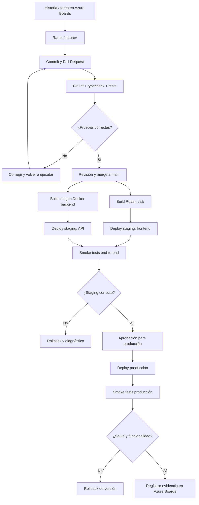

# Guía práctica de la diapositiva 36: CI/CD Full Stack
## Azure Boards → GitHub/Azure Repos → pruebas y build → despliegue → smoke tests → rollback

**Materia:** Lenguajes Web · Unidad 5  
**Escenario:** React + TypeScript (Vite), backend Flask / Django / Node.js con Express, PostgreSQL  
**Modalidad:** Laboratorio paso a paso · **Fecha de elaboración:** octubre de 2026

> **Alcance:** Esta guía desarrolla el flujo definido para la diapositiva 36 en la propuesta de presentación: **Azure Boards → GitHub/Azure Repos → pruebas y build → imagen o artefacto → despliegue frontend/backend → smoke tests → rollback**. La diapositiva fue propuesta en la conversación, no extraída de la presentación original de 15 páginas. Se amplía aquí con un ejemplo ejecutable, variantes y controles de seguridad. Adapte nombres, scripts y recursos a su aplicación.

---

## 0. Qué aprenderemos

Al finalizar, el estudiante podrá:

1. Relacionar una historia de usuario de **Azure Boards** con una rama, commits y un Pull Request.
2. Distinguir **integración continua (CI)** de **entrega/despliegue continuo (CD)**.
3. Configurar pruebas automáticas de React + TypeScript y del backend.
4. Generar el artefacto `dist/` y una imagen Docker del backend.
5. Publicar frontend y backend en un entorno de **staging** y después en **producción**.
6. Ejecutar pruebas de humo (*smoke tests*) y diagnosticar fallas.
7. Revertir una versión y explicar qué ocurre con las migraciones de base de datos.
8. Documentar evidencias y decisiones técnicas de su proyecto de tesis.

### 0.1 Diagrama del flujo



**Nota:** el diagrama es lógico. La implementación principal usa **GitHub Actions** para CI y CD con **Vercel** para frontend y **Render** para backend. Al final se incluye una variante con **Azure Pipelines** y adaptaciones para los casos A–E. Los servicios pueden cambiar de plan o comportamiento; verificar límites y facturación.

---

# PARTE I. Preparación del proyecto

## 1. Requisitos previos

- Repositorio Git en GitHub (o Azure Repos).
- Proyecto de Azure DevOps con acceso a **Boards**.
- Node.js LTS y npm.
- Python 3.11+ si el backend es Flask o Django; Node.js si es Express.
- Docker y Docker Compose para pruebas locales y para generar imágenes.
- Aplicación React + TypeScript creada con Vite.
- Backend que exponga al menos `GET /api/health`.
- PostgreSQL accesible desde el backend, sin publicar el puerto de la base de datos a Internet.
- Cuenta de hosting para frontend y backend; opcionalmente un registro de contenedores.
- Permisos para crear secretos, workflows y entornos de despliegue.

> **Importante:** Nunca subir `.env`, contraseñas, claves de servicio, tokens de Azure, contraseñas de PostgreSQL o claves privadas al repositorio. Las variables `VITE_*` se incrustan en el bundle público del frontend; no son secretos.

## 2. Estructura recomendada del repositorio

```text
tesis-fullstack/
├── frontend/
│   ├── src/
│   │   ├── App.tsx
│   │   └── ...
│   ├── package.json
│   ├── package-lock.json
│   ├── tsconfig.json
│   └── vite.config.ts
├── backend/
│   ├── app.py                  # Flask (ejemplo principal)
│   ├── requirements.txt
│   ├── tests/
│   │   └── test_health.py
│   ├── Dockerfile
│   └── .dockerignore
├── .github/
│   └── workflows/
│       ├── ci.yml
│       └── deploy.yml
├── compose.yaml               # desarrollo local, si aplica
├── .gitignore
└── README.md
```

Si los proyectos frontend y backend están en repositorios separados, cree workflows independientes y documente cómo se coordinan las versiones.

## 3. Crear la historia en Azure Boards

1. Ingresar a `https://dev.azure.com/` y abrir el proyecto.
2. Seleccionar **Boards → Work Items → New Work Item**.
3. Crear una **User Story** (o **Product Backlog Item**, según la plantilla del proceso).
4. Título sugerido: `Desplegar versión de tesis con CI/CD y pruebas de humo`.
5. Descripción: `Como equipo de desarrollo, queremos validar y publicar automáticamente el frontend React y la API para detectar errores antes de producción`.
6. Criterios de aceptación:
   - Un Pull Request ejecuta lint, typecheck y pruebas.
   - Un merge a `main` genera artefactos reproducibles.
   - La aplicación de staging responde por HTTPS.
   - `GET /api/health` devuelve estado satisfactorio.
   - La interfaz realiza una consulta real a la API.
   - Existe un procedimiento de rollback probado.
7. Guardar y registrar el identificador, por ejemplo `AB#123` (sustituir por el real).

**Vinculación:** si el repositorio está integrado con Azure Boards, usar el formato `AB#123` en mensajes de commit o descripciones de PR y comprobar que el vínculo aparezca en el elemento de trabajo. Si no aparece, revisar la integración **Project settings → GitHub connections** y permisos; escribir `AB#123` por sí solo no garantiza trazabilidad sin integración.

## 4. Estrategia de ramas y Pull Requests

```bash
git switch main
git pull --ff-only
git switch -c feature/AB123-ci-cd
# realizar cambios
git add .
git commit -m "ci: agregar validaciones de frontend y backend AB#123"
git push -u origin feature/AB123-ci-cd
```

1. Crear PR hacia `main`.
2. Revisar cambios, pruebas y archivos de configuración.
3. Proteger `main` con revisión obligatoria y checks requeridos cuando el plan y permisos lo permitan.
4. Evitar commits directos a producción.
5. Hacer merge solo si CI pasa.

---

# PARTE II. Preparar frontend y backend para CI

## 5. React + TypeScript: scripts de calidad

Dentro de `frontend/package.json`, **adapte los scripts existentes**. Ejemplo:

```json
{
  "scripts": {
    "dev": "vite",
    "build": "tsc -b && vite build",
    "preview": "vite preview",
    "lint": "eslint .",
    "typecheck": "tsc -b",
    "test": "vitest run"
  }
}
```

Instalar Vitest si aún no está configurado:

```bash
cd frontend
npm install -D vitest
npm run typecheck
npm run lint
npm run build
```

> `npm run test` requiere pruebas y configuración real de Vitest; no agregue el paso al pipeline hasta comprobarlo localmente. `tsc -b` depende del diseño de los archivos `tsconfig`; ajuste a `tsc --noEmit` si corresponde. **No sustituya ciegamente los scripts de su proyecto.**

### 5.1 Prueba sencilla del frontend

Ejemplo `frontend/src/saludo.ts`:

```ts
export function saludo(nombre: string): string {
  return `Hola, ${nombre}`;
}
```

Ejemplo `frontend/src/saludo.test.ts`:

```ts
import { describe, expect, it } from "vitest";
import { saludo } from "./saludo";

describe("saludo", () => {
  it("construye un mensaje", () => {
    expect(saludo("tesis")).toBe("Hola, tesis");
  });
});
```

Ejecutar:

```bash
npm run test
```

En una aplicación real, agregue pruebas de componentes, formularios, navegación y servicios API; una prueba trivial solo verifica que la infraestructura de pruebas funciona.

## 6. API: endpoint de salud

### Opción Flask (ejemplo principal)

`backend/app.py`:

```python
from flask import Flask, jsonify

app = Flask(__name__)

@app.get("/api/health")
def health():
    return jsonify(status="ok", service="tesis-api"), 200
```

`backend/requirements.txt` (versiones de ejemplo; fijar y revisar versiones en el proyecto):

```text
Flask
gunicorn
pytest
```

`backend/tests/test_health.py`:

```python
from app import app

def test_health():
    client = app.test_client()
    response = client.get("/api/health")
    assert response.status_code == 200
    assert response.get_json()["status"] == "ok"
```

Ejecutar:

```bash
cd backend
python -m venv .venv
source .venv/bin/activate       # Windows PowerShell: .venv\Scripts\Activate.ps1
pip install -r requirements.txt
python -m pytest -q
```

**Para producción:** `gunicorn --bind 0.0.0.0:${PORT:-8000} app:app`. En una aplicación real, añada validación de dependencias críticas y considere separar `/health/live` de `/health/ready`; una comprobación superficial no garantiza que PostgreSQL funcione.

### Opción Django

Agregar ruta `api/health/` en `urls.py`, por ejemplo:

```python
from django.http import JsonResponse
from django.urls import path

def health(request):
    return JsonResponse({"status": "ok", "service": "tesis-api"})

urlpatterns = [
    path("api/health", health),
]
```

Verificaciones CI recomendadas:

```bash
python manage.py check
python manage.py test
```

Para producción revisar `ALLOWED_HOSTS`, `CSRF_TRUSTED_ORIGINS`, configuración de archivos estáticos, migraciones y servidor WSGI/ASGI apropiado.

### Opción Express

Ejemplo mínimo en `backend/src/server.ts` (si se usa TypeScript):

```ts
import express from "express";

const app = express();
app.get("/api/health", (_req, res) => {
  res.json({ status: "ok", service: "tesis-api" });
});

const port = Number(process.env.PORT ?? 8000);
app.listen(port, "0.0.0.0", () => {
  console.log(`API escuchando en ${port}`);
});
```

Ejecutar el script de pruebas real del proyecto (`npm test`) y `npm run build` si transpila TypeScript. Configurar apagado ordenado, CORS, proxy y seguridad según el entorno.

## 7. Dockerizar el backend Flask

`backend/Dockerfile`:

```dockerfile
FROM python:3.12-slim

WORKDIR /app

ENV PYTHONDONTWRITEBYTECODE=1 \
    PYTHONUNBUFFERED=1

COPY requirements.txt .
RUN pip install --no-cache-dir -r requirements.txt

COPY . .

EXPOSE 8000
CMD ["gunicorn", "--bind", "0.0.0.0:8000", "--workers", "2", "app:app"]
```

`backend/.dockerignore`:

```text
.venv/
__pycache__/
.pytest_cache/
.env
.git/
```

Construir y probar:

```bash
docker build -t tesis-api:local ./backend
docker run --rm -p 8000:8000 tesis-api:local
```

En otra terminal:

```bash
curl --fail --show-error http://localhost:8000/api/health
```

> En plataformas que inyectan un puerto dinámico, el comando de arranque debe respetar `PORT`; la imagen anterior fija 8000 y sirve para entornos donde se configura ese puerto explícitamente. No use la imagen como ejemplo de seguridad endurecida: para producción se recomienda usuario no root, versiones fijadas y análisis de vulnerabilidades.

---

# PARTE III. Integración continua (CI) con GitHub Actions

## 8. Crear el workflow de CI

Archivo `.github/workflows/ci.yml`:

```yaml
name: CI - Frontend y Backend

on:
  pull_request:
    branches: [main]
  push:
    branches: [main]

permissions:
  contents: read

jobs:
  frontend:
    name: React TypeScript
    runs-on: ubuntu-latest
    defaults:
      run:
        working-directory: frontend
    steps:
      - uses: actions/checkout@v4

      - uses: actions/setup-node@v4
        with:
          node-version: "22"
          cache: npm
          cache-dependency-path: frontend/package-lock.json

      - name: Instalar dependencias
        run: npm ci

      - name: Revisar tipos
        run: npm run typecheck

      - name: Lint
        run: npm run lint

      - name: Pruebas
        run: npm run test

      - name: Compilar
        run: npm run build

      - name: Guardar dist
        uses: actions/upload-artifact@v4
        with:
          name: frontend-dist
          path: frontend/dist/
          if-no-files-found: error

  backend:
    name: Flask API
    runs-on: ubuntu-latest
    defaults:
      run:
        working-directory: backend
    steps:
      - uses: actions/checkout@v4

      - uses: actions/setup-python@v5
        with:
          python-version: "3.12"
          cache: pip
          cache-dependency-path: backend/requirements.txt

      - name: Instalar dependencias
        run: pip install -r requirements.txt

      - name: Pruebas
        run: python -m pytest -q

      - name: Construir imagen
        run: docker build -t tesis-api:ci .
```

**Adaptación importante:** este workflow asume que el frontend tiene `package-lock.json`, scripts `typecheck`, `lint`, `test` y `build`; y que el backend es Flask. Para Django cambie las pruebas por `manage.py check` y `manage.py test`; para Express use Node, `npm ci`, pruebas y build del backend.

### 8.1 Cómo probar CI

1. Crear la rama de trabajo y añadir `ci.yml`.
2. Hacer push.
3. Abrir el Pull Request.
4. En GitHub, abrir la pestaña **Actions**.
5. Verificar ambos jobs en verde.
6. Entrar a los logs y confirmar cada comando.
7. Provocar intencionalmente una falla en una prueba y verificar que CI impide el merge cuando el check es obligatorio.
8. Corregir la falla y comprobar que el pipeline vuelve a verde.

**Evidencia:** captura del PR con checks y URL de la ejecución del workflow.

### 8.2 Qué NO hace CI todavía

- No despliega la aplicación.
- No verifica credenciales o configuración real de producción.
- No sustituye pruebas de integración.
- No garantiza ausencia de vulnerabilidades.
- No ejecuta migraciones de base de datos.

---

# PARTE IV. Entornos y despliegue continuo (CD)

## 9. Separar staging y producción

| Aspecto | Staging | Producción |
|---|---|---|
| Propósito | Validación previa | Usuarios finales |
| URL ejemplo | `staging.ejemplo.edu` | `app.ejemplo.edu` |
| Base de datos | BD de prueba | BD real separada |
| Credenciales | De prueba | Secretos productivos |
| Despliegue | Automático tras CI | Con aprobación |
| Datos | Sintéticos o anonimizados | Reales, con controles |

No apuntar staging a la base de datos productiva salvo diseño explícito y justificado. Nunca copiar datos personales reales a entornos de prueba sin autorización y protección adecuada.

## 10. Preparar despliegue en Vercel (frontend)

1. Crear proyecto en Vercel e importar el repositorio.
2. Si el repositorio es monorepo, establecer **Root Directory** = `frontend`.
3. Framework: Vite.
4. Build command: `npm run build`.
5. Output directory: `dist`.
6. Configurar variable `VITE_API_URL` con URL HTTPS de la API del entorno.
7. Revisar la configuración de rutas SPA. Si se usa React Router con rutas cliente, establecer un rewrite hacia `index.html` según la configuración de Vercel del proyecto.
8. Publicar y probar una ruta anidada refrescando la página.
9. Mantener deployments de preview separados del dominio de producción.

Ejemplo de configuración de frontend:

```ts
// frontend/src/config.ts
export const API_URL = import.meta.env.VITE_API_URL;
if (!API_URL) {
  throw new Error("Falta VITE_API_URL");
}
```

> `VITE_API_URL` es pública. Solo debe contener la URL del backend, nunca una contraseña o token secreto.

### 10.1 Despliegue por integración Git

La ruta **más sencilla y recomendada para clase** es habilitar la integración de Vercel con GitHub. Vercel construye el frontend cuando hay nuevos commits, según su configuración. Si se necesita que el despliegue ocurra *solo después* de aprobar CI, use controles de protección de rama y/o un flujo de despliegue explícito con CLI/API; la integración Git por sí sola no garantiza dependencia estricta entre CI y CD.

## 11. Preparar despliegue del backend en Render

1. Crear un servicio web en Render vinculado al repositorio.
2. Elegir **Root Directory** = `backend`.
3. Elegir runtime Python o Docker.
4. Para Flask sin Docker, build command de ejemplo: `pip install -r requirements.txt`.
5. Start command de ejemplo: `gunicorn --bind 0.0.0.0:$PORT app:app`.
6. Definir `DATABASE_URL`, `SECRET_KEY` y otras variables **solo en el servidor**.
7. Configurar el health check path: `/api/health`.
8. Configurar dominio HTTPS y CORS con el dominio del frontend.
9. Verificar logs, arranque, migraciones y acceso a PostgreSQL.
10. Definir si el servicio despliega automáticamente por Git o mediante una llamada controlada desde el pipeline.

**Advertencia de costos:** los niveles gratuitos y las bases de datos administradas pueden tener suspensión, expiración, cuotas o cargos. Revisar los planes vigentes antes de la práctica.

## 12. Automatizar CD de forma controlada

Para que el ejemplo sea claro y no dependa de CLI de proveedores, se muestra un workflow que:

- Espera a que termine CI en `main`.
- Usa un **deploy hook** de Vercel para solicitar publicación.
- Usa un **deploy hook** de Render para solicitar publicación.
- Ejecuta smoke tests contra URLs de **staging**.
- Requiere que los hooks estén configurados para el entorno y rama correctos.

**Antes de comenzar:** crear los hooks en los paneles de cada proveedor. Guardar sus URLs completas como secretos del repositorio. **No mostrar ni copiar las URLs en documentos públicos**, porque funcionan como credenciales.

En GitHub → **Settings → Secrets and variables → Actions**:

- Secretos: `VERCEL_STAGING_DEPLOY_HOOK`, `RENDER_STAGING_DEPLOY_HOOK`.
- Variables: `STAGING_FRONTEND_URL`, `STAGING_BACKEND_URL`.

Archivo `.github/workflows/deploy.yml`:

```yaml
name: CD - Staging

on:
  workflow_run:
    workflows: ["CI - Frontend y Backend"]
    types: [completed]
    branches: [main]

permissions:
  contents: read

concurrency:
  group: staging-deploy
  cancel-in-progress: false

jobs:
  deploy:
    if: >-
      ${{ github.event.workflow_run.conclusion == 'success'
          && github.event.workflow_run.head_repository.full_name == github.repository }}
    runs-on: ubuntu-latest
    environment: staging

    steps:
      - name: Solicitar deploy frontend
        env:
          HOOK: ${{ secrets.VERCEL_STAGING_DEPLOY_HOOK }}
        run: |
          test -n "$HOOK"
          curl --fail --show-error --silent -X POST "$HOOK"

      - name: Solicitar deploy backend
        env:
          HOOK: ${{ secrets.RENDER_STAGING_DEPLOY_HOOK }}
        run: |
          test -n "$HOOK"
          curl --fail --show-error --silent -X POST "$HOOK"

      - name: Esperar API staging
        env:
          URL: ${{ vars.STAGING_BACKEND_URL }}
        run: |
          test -n "$URL"
          for i in $(seq 1 30); do
            if curl --fail --silent --show-error \
              --max-time 10 "$URL/api/health" > /dev/null; then
              echo "API responde"
              exit 0
            fi
            sleep 10
          done
          echo "API no respondió"; exit 1

      - name: Comprobar frontend staging
        env:
          URL: ${{ vars.STAGING_FRONTEND_URL }}
        run: |
          test -n "$URL"
          curl --fail --show-error --silent --max-time 20 "$URL" > /dev/null
```

### 12.1 Limitación importante del ejemplo de hooks

Los hooks **solicitan** un despliegue, pero no prueban por sí solos que el despliegue recién solicitado haya terminado. Si el entorno ya estaba saludable, las pruebas anteriores podrían aprobarse contra una **versión anterior**.

**Para uso riguroso**, se debe añadir:

1. Una variable de versión en frontend y backend (por ejemplo, SHA de commit).
2. Un endpoint `/api/version` y un archivo/version visible del frontend.
3. Consulta de estado del despliegue mediante la API del proveedor o su CLI.
4. Comparación de la versión publicada con `github.event.workflow_run.head_sha`.
5. Solo después ejecutar smoke tests funcionales.
6. Bloquear despliegues concurrentes de producción y evitar que un commit posterior cambie la versión mientras se verifica.

Para una primera práctica académica, puede comenzar con hooks y después mejorar el pipeline con verificación de versión. **No presentar la versión simple como despliegue transaccional ni como prueba de que el commit correcto está publicado.**

### 12.2 Riesgo de seguridad de `workflow_run`

`workflow_run` es un evento con privilegios potencialmente superiores. No descargar ni ejecutar artefactos no confiables del workflow de un PR, y no ejecutar código de la rama que disparó CI dentro del job con secretos. El ejemplo solo usa hooks configurados como secretos y filtra repositorios externos; para un entorno sensible, añadir aprobación y controles de rama/entorno.

---

# PARTE V. Smoke tests, pruebas de integración y aprobación

## 13. Diferencia entre tipos de prueba

- **Unitarias:** validan funciones/componentes aislados.
- **Integración:** validan comunicación API–BD y servicios.
- **End-to-end:** recorren un flujo completo de usuario.
- **Smoke tests:** verifican rápidamente que el sistema publicado arranca y que sus funciones críticas responden.
- **Monitoreo:** observa comportamiento continuo después del despliegue.

## 14. Smoke tests mínimos con curl

```bash
# API
curl --fail --show-error https://api-staging.ejemplo.edu/api/health

# Frontend
curl --fail --show-error https://staging.ejemplo.edu/
```

Estas comprobaciones solo detectan errores HTTP evidentes. Agregar al menos una prueba de flujo real: login de usuario de prueba, consulta de un registro de prueba o creación/lectura/eliminación de un dato sintético.

### 14.1 Ejemplo de smoke test con Playwright

En el frontend:

```bash
npm install -D @playwright/test
npx playwright install chromium
```

`frontend/tests/smoke.spec.ts`:

```ts
import { test, expect } from "@playwright/test";

test("la aplicación muestra la página principal", async ({ page }) => {
  const base = process.env.STAGING_FRONTEND_URL;
  if (!base) throw new Error("Falta STAGING_FRONTEND_URL");

  await page.goto(base);
  await expect(page.locator("body")).toBeVisible();
  // Sustituir por un elemento real y estable de la aplicación:
  // await expect(page.getByRole("heading", { name: /dashboard/i })).toBeVisible();
});
```

Ejecutar:

```bash
STAGING_FRONTEND_URL=https://staging.ejemplo.edu \
npx playwright test
```

> La prueba anterior es intencionalmente mínima. Debe ampliarse para comprobar un flujo funcional y una llamada real a la API. Si el frontend requiere autenticación, usar una cuenta exclusiva de pruebas y secretos de staging.

## 15. Aprobación antes de producción

1. Confirmar CI en verde.
2. Confirmar versión exacta en staging.
3. Ejecutar smoke tests y pruebas funcionales.
4. Revisar logs y migraciones.
5. Verificar respaldos recientes.
6. Solicitar aprobación de un responsable.
7. Publicar **la misma versión probada**, no reconstruir desde un commit distinto.
8. Ejecutar smoke tests de producción y registrar el resultado.

Para GitHub Actions, usar un **environment** llamado `production` con revisores requeridos si el plan/visibilidad del repositorio lo permite. Si no está disponible, realizar aprobación manual documentada.

---

# PARTE VI. Rollback y recuperación

## 16. Qué es un rollback

Rollback = volver a una versión funcional anterior cuando el despliegue falla. Debe considerar por separado:

1. **Frontend:** versión anterior de los archivos estáticos.
2. **Backend:** imagen o release anterior.
3. **Base de datos:** migraciones y datos; no siempre es seguro revertir esquema o restaurar backups.

### 16.1 Rollback en Vercel

1. Abrir el proyecto → Deployments.
2. Identificar la última versión funcional (comprobar commit SHA).
3. Utilizar la opción disponible de promoción/rollback a ese despliegue.
4. Verificar dominio, rutas y consumo de API.
5. Registrar hora, causa y versión restaurada.

Las etiquetas exactas de los botones pueden variar según la interfaz y el plan.

### 16.2 Rollback en Render

1. Abrir el servicio → historial de despliegues.
2. Identificar la versión anterior que funcionaba.
3. Usar la opción de redeploy/rollback que ofrezca el servicio; si no existe, desplegar explícitamente la imagen o commit anterior.
4. Comprobar que el servicio apunta a la versión esperada.
5. Ejecutar smoke tests y revisar logs.

**No confundir** “redeploy latest” con “rollback”: volver a desplegar la última versión defectuosa no resuelve el incidente.

### 16.3 Rollback con Docker Compose (casos A y D)

Es recomendable publicar imágenes con etiquetas inmutables o digest, no depender solo de `latest`.

Ejemplo `compose.yaml`:

```yaml
services:
  backend:
    image: ghcr.io/organizacion/tesis-api:${API_TAG}
    env_file: .env
    restart: unless-stopped
```

Archivo de entorno de despliegue:

```dotenv
API_TAG=sha-abcdef0
```

Cambiar a una versión conocida:

```bash
# Editar API_TAG por la versión estable anterior
docker compose pull backend
docker compose up -d --no-deps backend
docker compose ps
curl --fail http://localhost:8000/api/health
```

Si se usa un proxy inverso, verificar también la URL pública. Asegurar que el tag anterior todavía existe en el registro.

### 16.4 Migraciones de base de datos: el punto crítico

**No hacer rollback automático de PostgreSQL solo porque falla un frontend o una API.** Restaurar una base puede perder registros legítimos creados después del respaldo.

Aplicar el patrón **expand–migrate–contract**:

1. **Expand:** agregar columnas/tablas nuevas sin eliminar las anteriores.
2. **Migrate:** actualizar código y datos de forma compatible.
3. **Contract:** retirar elementos antiguos solo cuando ya no se necesitan.
4. Mantener una ventana en la que la versión anterior y nueva del backend sean compatibles con el esquema.
5. Probar restauración de respaldos en un entorno aislado.

Antes de migraciones destructivas, exigir revisión, backup y plan explícito de recuperación.

## 17. Simulación controlada de falla

En staging:

1. Registrar la versión estable actual.
2. Introducir una falla inocua en un endpoint o en la interfaz.
3. Crear PR y verificar si las pruebas detectan el problema.
4. Si CI no lo detecta, publicar en staging para demostrar la importancia de smoke tests.
5. Identificar la falla en logs y alertas.
6. Restaurar la versión estable anterior.
7. Comprobar que frontend, API y base siguen funcionando.
8. Registrar la causa raíz y proponer una prueba nueva que prevenga la repetición.

**Nunca** provocar fallas deliberadas en producción con datos reales.

---

# PARTE VII. Adaptación a las arquitecturas A–E

## 18. ¿Cómo cambia CD según el despliegue?

| Caso | Frontend | Backend | BD | Estrategia CD |
|---|---|---|---|---|
| **A** Docker local + túnel | Nginx en contenedor | Contenedor local | Contenedor con volumen | CI publica imágenes; servidor local hace pull y compose; túnel expone proxy |
| **B** Vercel + PaaS | Vercel | Render/Railway/Fly.io | Administrada | Integraciones Git, deploy hooks o CLI/API |
| **C** Azure for Students | Static Web Apps | App Service/Container Apps | Azure PostgreSQL | Azure Pipelines y tareas de despliegue Azure |
| **D** VPS + Compose | Nginx contenedor | Docker en VPS | Contenedor con volumen | Registro de imágenes + SSH seguro + compose |
| **E** AWS | Amplify | App Runner/ECS | RDS | Pipelines y despliegues por imagen/servicio AWS |

### Caso A: servidor local con túnel

- CI se ejecuta en GitHub/Azure.
- Construir imágenes y publicarlas en un registro.
- Un mecanismo autorizado actualiza el servidor local (por ejemplo, agente self-hosted endurecido o despliegue manual controlado).
- `docker compose pull && docker compose up -d`.
- Verificar el endpoint HTTPS del túnel.
- **Precaución:** no ejecutar jobs no confiables en un runner self-hosted con acceso a la LAN, credenciales o Docker.

### Caso B: Vercel + Render

- CI verifica React y API.
- Deploy de staging mediante integración Git o API/hooks.
- Smoke tests con versión.
- Aprobación.
- Promover/desplegar versión de producción.
- Rollback mediante historial de despliegues.

### Caso C: Azure DevOps y Azure

- Azure Boards registra historias.
- Azure Repos o GitHub guarda código.
- Azure Pipelines compila, prueba y publica artefactos.
- Desplegar frontend en Static Web Apps y backend en App Service/Container Apps.
- Usar **service connection** con identidad federada cuando sea compatible, en lugar de credenciales permanentes.
- Proteger producción mediante aprobaciones y checks.

### Caso D: VPS

- CI construye imágenes con tag de commit.
- Publicarlas en registro.
- El VPS hace pull de tags específicos.
- Compose actualiza servicios sin borrar volúmenes.
- Smoke tests y rollback por tag anterior.
- Controlar SSH, firewall, usuario sin privilegios, backups y espacio en disco.

### Caso E: AWS

- CI crea imagen backend y la publica en ECR.
- Amplify despliega frontend desde Git o flujo controlado.
- App Runner/ECS usa versión concreta de imagen.
- RDS permanece separado de los despliegues de aplicación.
- CloudWatch y alarmas ayudan a verificar la salud.
- Usar IAM de mínimo privilegio e identidad federada para CI/CD cuando sea posible.

---

# PARTE VIII. Variante con Azure Pipelines

## 19. Cuándo usar Azure Pipelines

Si el grupo ya trabaja con **Azure Boards**, puede mantener GitHub como repositorio y ejecutar pipelines en Azure DevOps, o migrar a Azure Repos. No es necesario usar Azure Repos para utilizar Azure Boards.

### 19.1 Conectar el repositorio

1. En Azure DevOps, abrir **Pipelines → New pipeline**.
2. Elegir GitHub o Azure Repos.
3. Autorizar el acceso al repositorio.
4. Elegir YAML.
5. Crear `azure-pipelines.yml` en la raíz.
6. Configurar políticas de ramas y permisos de pipeline.

### 19.2 Ejemplo de pipeline CI para Flask + React

```yaml
trigger:
  branches:
    include:
      - main

pr:
  branches:
    include:
      - main

pool:
  vmImage: ubuntu-latest

stages:
  - stage: CI
    displayName: Validar frontend y backend
    jobs:
      - job: Frontend
        steps:
          - task: NodeTool@0
            inputs:
              versionSpec: '22.x'
          - script: npm ci
            workingDirectory: frontend
            displayName: Instalar frontend
          - script: npm run typecheck && npm run lint && npm run test && npm run build
            workingDirectory: frontend
            displayName: Validar y compilar React
          - publish: frontend/dist
            artifact: frontend-dist

      - job: Backend
        steps:
          - task: UsePythonVersion@0
            inputs:
              versionSpec: '3.12'
          - script: |
              python -m pip install -r requirements.txt
              python -m pytest -q
            workingDirectory: backend
            displayName: Probar API Flask
          - script: docker build -t tesis-api:ci .
            workingDirectory: backend
            displayName: Construir imagen
```

**Limitaciones y ajustes:** la disponibilidad de agentes hospedados, las tareas, la autorización de PR y la integración con GitHub dependen de configuración, permisos y cuotas. Este ejemplo realiza **CI**, no CD. Para publicar en Azure, agregue etapas de despliegue con conexión de servicio, artefactos versionados y aprobaciones de entorno.

### 19.3 Añadir CD a Azure

1. Crear recursos Azure para staging y producción.
2. Configurar una **service connection** restringida al grupo de recursos.
3. Crear un **Environment** `staging` y otro `production`.
4. Añadir etapa `Deploy_Staging` dependiente de CI.
5. Publicar artefactos y desplegar backend con tareas oficiales del servicio elegido.
6. Ejecutar smoke tests con la versión publicada.
7. Configurar aprobación para `production`.
8. Desplegar exactamente la versión validada.
9. Documentar rollback por versión y procedimiento de migraciones.

> Las tareas YAML exactas de CD dependen de si el backend utiliza App Service, Container Apps, VPS o App Runner. No existe una sola tarea de despliegue válida para todas las arquitecturas A–E.

---

# PARTE IX. Seguridad y buenas prácticas

## 20. Lista de verificación obligatoria

- [ ] Repositorio sin contraseñas, tokens ni archivos `.env`.
- [ ] Branch protection / PR con revisión y checks.
- [ ] Dependencias fijadas y lockfiles versionados.
- [ ] CI ejecuta typecheck, lint, tests y build.
- [ ] Secretos guardados en el gestor de secretos de CI/CD o proveedor.
- [ ] Credenciales con permisos mínimos y rotación.
- [ ] HTTPS y dominios configurados.
- [ ] Backend aplica autenticación y autorización.
- [ ] CORS restringido a orígenes necesarios.
- [ ] PostgreSQL no expuesto a Internet.
- [ ] Staging y producción usan bases separadas.
- [ ] Migraciones y backups probados.
- [ ] Versiones de despliegue identificables por SHA.
- [ ] Smoke tests verifican versión y funcionalidad.
- [ ] Existe rollback documentado y probado.
- [ ] Logs no contienen datos sensibles.
- [ ] Hay alertas de costo/consumo en servicios cloud.

## 21. Errores frecuentes y solución

| Síntoma | Posible causa | Diagnóstico / corrección |
|---|---|---|
| `npm ci` falla | Lockfile ausente o desactualizado | Ejecutar `npm install` localmente, revisar y subir `package-lock.json` |
| Typecheck falla | Tipos o `tsconfig` | Reproducir con `npm run typecheck`; corregir tipos |
| CI no ejecuta | Ruta de YAML, evento o permisos | Revisar `.github/workflows/` y pestaña Actions |
| API 502/503 | Backend no arranca o puerto incorrecto | Revisar logs, comando de inicio y `PORT` |
| Error CORS | Dominio frontend no permitido | Configurar origen HTTPS exacto en backend |
| Frontend funciona pero `/ruta` da 404 | SPA sin rewrite | Configurar fallback a `index.html` |
| API sin BD | `DATABASE_URL`, red o migraciones | Verificar secretos, conectividad y esquema |
| Smoke tests pasan con código viejo | No se verificó versión | Comparar SHA desplegado con SHA de CI |
| Rollback no arregla el sistema | Migración incompatible | Usar migraciones compatibles y plan de recuperación |
| Deploy no corre tras CI | Nombre del workflow o evento incorrecto | Confirmar `workflow_run.workflows` coincide exactamente con `name:` |

---

# PARTE X. Actividad para estudiantes

## 22. Práctica: pipeline completo del proyecto de tesis

**Consigna:** implementar CI/CD para una aplicación Full Stack de tres capas, eligiendo una de las arquitecturas A–E.

### Entregables

1. Identificador y captura de la historia en Azure Boards.
2. URL del repositorio, rama y Pull Request.
3. Captura y enlace de una ejecución CI exitosa.
4. Evidencia de prueba fallida y posterior corrección.
5. Artefacto frontend y versión de backend.
6. Diagrama de despliegue de la arquitectura elegida.
7. URL de staging o túnel y resultados de smoke tests.
8. Evidencia de versión exacta desplegada (SHA).
9. Registro de aprobación de producción, si aplica.
10. Evidencia de rollback en staging.
11. Explicación de cómo se manejan secretos, BD y migraciones.
12. Reflexión de 1 página: qué automatizaron, qué quedó manual y por qué.

### Rúbrica (100 puntos)

| Criterio | Puntos |
|---|---:|
| Trazabilidad Azure Boards → PR/commits | 10 |
| CI: tipos, lint, pruebas y build | 20 |
| Artefactos e imágenes versionadas | 10 |
| Despliegue staging funcional | 15 |
| Smoke tests y verificación de versión | 15 |
| Seguridad y gestión de secretos | 10 |
| Rollback y persistencia de datos | 10 |
| Evidencias, explicación y defensa técnica | 10 |
| **Total** | **100** |

### Preguntas para la defensa

1. ¿Qué diferencia hay entre integración continua y despliegue continuo?
2. ¿Por qué una prueba HTTP 200 no basta para validar una aplicación Full Stack?
3. ¿Cómo sabe el pipeline qué commit está realmente publicado?
4. ¿Qué secretos son del frontend y cuáles deben permanecer en el backend?
5. ¿Qué pasa con PostgreSQL si se revierte el contenedor del backend?
6. ¿Qué ventajas y riesgos tiene usar un runner propio en un servidor local?
7. ¿Cómo relaciona el equipo una historia de Azure Boards con el despliegue?
8. ¿Qué paso de su pipeline exige aprobación humana y por qué?

---

# Referencias y consulta

Documentación oficial que debe revisarse antes de ejecutar los pasos, especialmente cuando cambian interfaces, planes o sintaxis:

- GitHub Actions: https://docs.github.com/en/actions
- Eventos `workflow_run`: https://docs.github.com/en/actions/reference/events-that-trigger-workflows
- GitHub Environments: https://docs.github.com/en/actions/deployment/targeting-different-environments/using-environments-for-deployment
- Azure Boards y GitHub: https://learn.microsoft.com/en-us/azure/devops/boards/github/
- Azure Pipelines YAML: https://learn.microsoft.com/en-us/azure/devops/pipelines/yaml-schema/
- React + TypeScript: https://react.dev/learn/typescript
- Vite: https://vite.dev/guide/
- Vitest: https://vitest.dev/
- Playwright: https://playwright.dev/
- Docker Compose: https://docs.docker.com/compose/
- Vercel: https://vercel.com/docs
- Render: https://render.com/docs
- Azure Static Web Apps: https://learn.microsoft.com/en-us/azure/static-web-apps/
- AWS Amplify: https://docs.aws.amazon.com/amplify/
- AWS App Runner: https://docs.aws.amazon.com/apprunner/

**Nota docente:** El propósito es que los alumnos comprendan la trazabilidad y la automatización, no que memoricen botones de un proveedor. Para la evaluación, privilegiar una demostración verificable del flujo completo y una explicación del rollback sobre una arquitectura innecesariamente compleja.
