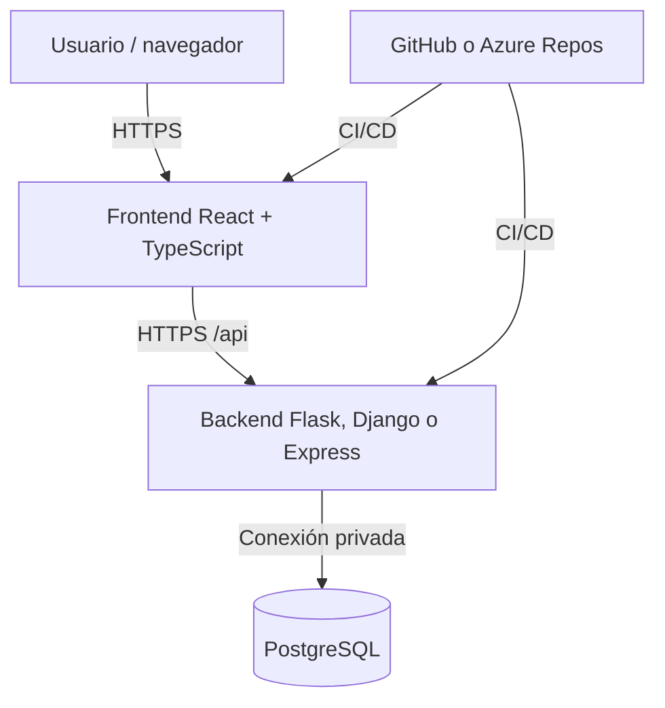
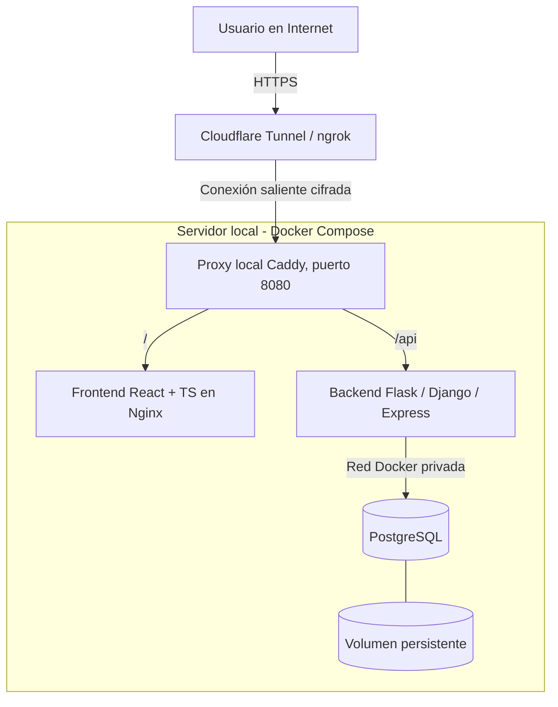
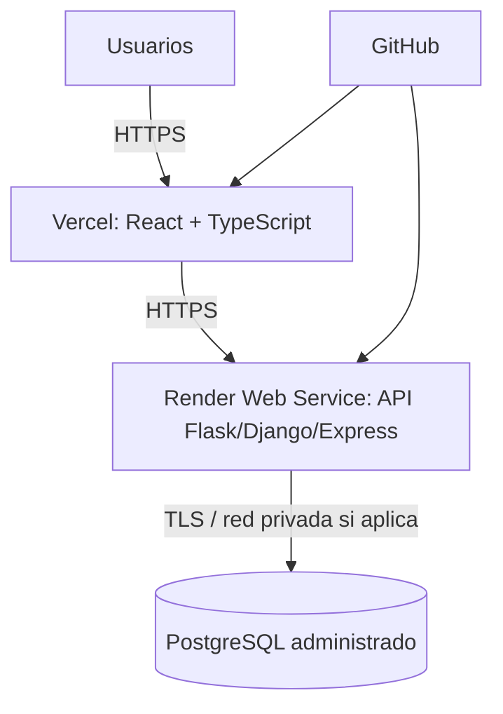
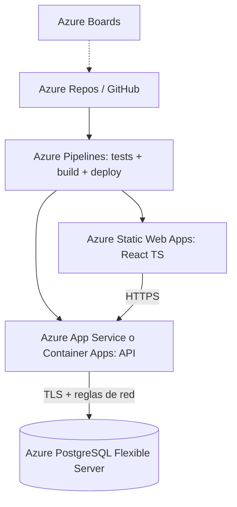
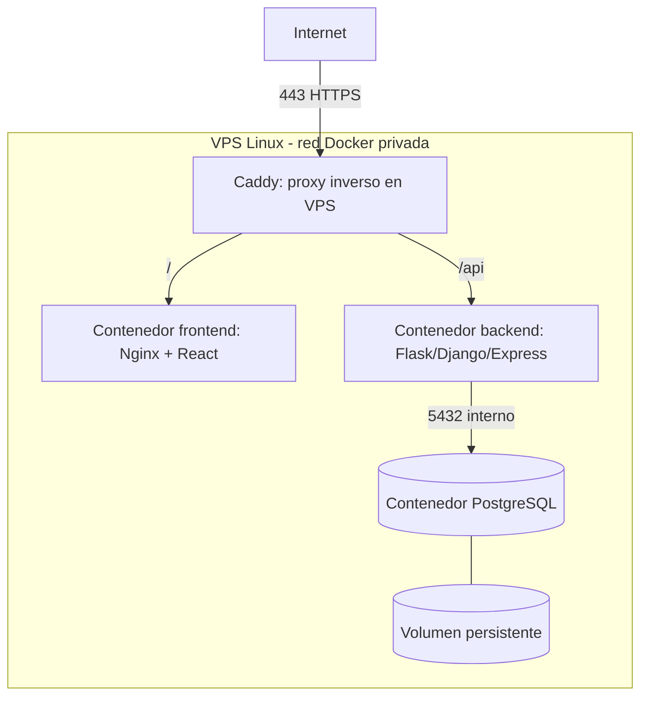
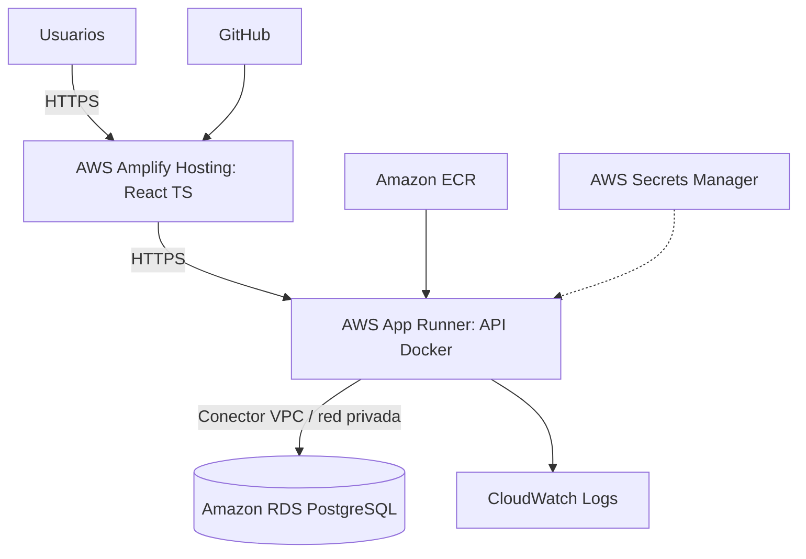

# Guías prácticas de despliegue Full Stack — Casos A, B, C, D y E

**Asignatura:** Lenguajes Web · Unidad 5 · Aplicaciones Web y Cómputo en la Nube  
**Stack de referencia:** React + TypeScript + Vite · Flask / Django / Express · PostgreSQL  
**Modalidad:** práctica guiada para proyectos de tesis · **Actualización:** octubre de 2026

> **Alcance y procedencia.** Este documento desarrolla los casos A–E definidos en la ampliación didáctica de `LW2025-U5.pdf`. El PDF original presenta AWS Amplify, Vercel y fundamentos cloud, pero **no incluye** los procedimientos detallados aquí descritos. Los comandos, configuraciones y recomendaciones son una propuesta de implementación complementaria. Las interfaces, cuotas y precios de los proveedores cambian; compruébelos en su documentación antes de desplegar. Ninguna de estas arquitecturas garantiza costo cero permanente.

## Índice

1. [Convenciones y preparación común](#1-convenciones-y-preparación-común)
2. [Caso A — Docker local + Cloudflare Tunnel o ngrok](#2-caso-a--docker-local--cloudflare-tunnel-o-ngrok)
3. [Caso B — Vercel + Render + PostgreSQL administrado](#3-caso-b--vercel--render--postgresql-administrado)
4. [Caso C — Azure for Students + Azure DevOps](#4-caso-c--azure-for-students--azure-devops)
5. [Caso D — VPS Linux + Docker Compose](#5-caso-d--vps-linux--docker-compose)
6. [Caso E — AWS Amplify + App Runner + RDS](#6-caso-e--aws-amplify--app-runner--rds)
7. [Comparación, evidencias y rúbrica](#7-comparación-evidencias-y-rúbrica)
8. [Referencias oficiales](#8-referencias-oficiales)

---

# 1. Convenciones y preparación común

## 1.1 Objetivo

Desplegar una aplicación con tres **capas lógicas**:



**Importante:** tres capas lógicas no equivalen siempre a tres contenedores físicos. En los **casos A y D** sí se conservan tres contenedores de aplicación; en B, C y E el frontend o la base de datos se alojan como servicios administrados.

## 1.2 Requisitos previos

- Node.js LTS, npm, Git, Docker Engine/Compose para pruebas locales y editor de código.
- Repositorio Git (GitHub o Azure Repos), acceso a la plataforma elegida y dominio opcional.
- Proyecto React + TypeScript generado con Vite.
- API Flask, Django o Express con endpoint `GET /api/health` que devuelva HTTP 200 y JSON.
- PostgreSQL y scripts de migración/versionado del esquema.
- Conocimientos de HTTP, DNS, variables de entorno, JSON, redes y Git.

## 1.3 Estructura sugerida del repositorio

```text
proyecto-tesis/
├── frontend/
│   ├── src/
│   ├── package.json
│   ├── .env.example
│   └── Dockerfile
├── backend/
│   ├── Dockerfile
│   ├── .env.example
│   └── ... archivos Flask / Django / Express
├── deploy/
│   ├── Caddyfile
│   └── compose.yaml
├── .gitignore
└── README.md
```

### Preparación del frontend

```bash
cd frontend
npm install
npm run build
# El resultado habitual de Vite se genera en frontend/dist/
```

Archivo `frontend/.env.example`:

```dotenv
VITE_API_URL=https://api.ejemplo.edu.mx
```

Cliente HTTP mínimo en `frontend/src/services/api.ts`:

```ts
const API_URL = import.meta.env.VITE_API_URL ?? "/api";

export interface HealthResponse {
  status: string;
}

export async function checkHealth(): Promise<HealthResponse> {
  const response = await fetch(`${API_URL}/api/health`);
  if (!response.ok) throw new Error(`HTTP ${response.status}`);
  return (await response.json()) as HealthResponse;
}
```

> Si se utiliza un proxy que ya sirve la API bajo `/api` en el mismo dominio, configure `VITE_API_URL` como cadena vacía (`VITE_API_URL=`) y ajuste el cliente para evitar rutas duplicadas. Para simplificar la práctica se recomienda **un dominio separado para la API** en los casos B, C y E, y **rutas relativas** en D.

### Contrato mínimo del backend

Todos los frameworks deben exponer:

```http
GET /api/health
HTTP/1.1 200 OK
Content-Type: application/json

{"status":"ok"}
```

**Express** (`backend/src/server.js`, adaptarlo a la estructura del alumno):

```js
import express from "express";
import cors from "cors";
const app = express();
app.use(express.json());
app.use(cors({ origin: process.env.FRONTEND_ORIGIN }));
app.get("/api/health", (_req, res) => res.json({ status: "ok" }));
app.listen(process.env.PORT || 3000, "0.0.0.0");
```

Instalación: `npm install express cors`. Configurar `"type": "module"` en `package.json` si se usa `import` en Node.js. En producción, validar `FRONTEND_ORIGIN` y agregar rutas reales.

**Flask** (`backend/app.py`):

```py
from flask import Flask, jsonify
app = Flask(__name__)

@app.get('/api/health')
def health():
    return jsonify(status='ok')
```

Instalación: `pip install flask gunicorn`. Ejecución de producción Linux: `gunicorn --bind 0.0.0.0:${PORT:-8000} app:app`. Si frontend y API usan dominios diferentes, configurar CORS restringido (por ejemplo con `flask-cors`).

**Django**: agregar una vista `health` que devuelva `JsonResponse({'status': 'ok'})` y mapearla a `/api/health`. Configurar `ALLOWED_HOSTS`, `CSRF_TRUSTED_ORIGINS`, `STATIC_ROOT` y `collectstatic` según la aplicación. Ejecutar migraciones antes de atender tráfico; para WSGI usar `gunicorn nombre_proyecto.wsgi:application`.

### Variables de entorno comunes

| Variable | Ubicación | Uso |
|---|---|---|
| `VITE_API_URL` | Compilación frontend | URL pública de API; **nunca secretos** |
| `DATABASE_URL` | Backend | Cadena PostgreSQL; secreto |
| `FRONTEND_ORIGIN` | Backend | Origen permitido para CORS |
| `PORT` | Backend | Puerto HTTP de escucha |
| `SECRET_KEY` / `JWT_SECRET` | Backend | Secreto de autenticación |
| `NODE_ENV` / `FLASK_ENV` | Backend | Entorno de ejecución, según framework |

**No subir** archivos `.env` reales al repositorio. Añadir `.env`, `.env.*.local`, claves privadas y archivos de credenciales a `.gitignore`. No confiar en el tipado TypeScript para validar JSON externo: usar validación en runtime cuando sea necesario.

## 1.4 Pruebas comunes antes del despliegue

```bash
# Desde la raíz del repositorio
cd frontend && npm ci && npm run build
# Comprobar endpoint de API ya iniciada:
curl -i http://localhost:8000/api/health
```

Verificar también creación y lectura de un registro real de la base de datos, reinicio del backend, manejo de errores, CORS y que el frontend no contenga credenciales.

---

# 2. Caso A — Docker local + Cloudflare Tunnel o ngrok

## 2.1 Fundamento y cuándo conviene

En esta alternativa los **tres contenedores de aplicación** (frontend React + TypeScript, API Flask/Django/Express y PostgreSQL) permanecen en una computadora o servidor Linux propio. Un túnel saliente de **Cloudflare Tunnel** o **ngrok** publica el servicio HTTP local a través de HTTPS. **No es alojamiento cloud del cómputo**: la aplicación sigue dependiendo de la electricidad, la conexión y el mantenimiento del equipo del alumno. Es útil para demostraciones, laboratorios y proyectos con conocimientos de Sysadmin.



> **Topología:** tres contenedores de aplicación + un contenedor auxiliar de proxy Caddy + un contenedor auxiliar del túnel, si se ejecutan ambos en Docker. El requisito académico de tres capas se conserva; los auxiliares no son nuevas capas de negocio. Para la primera prueba puede omitirse el contenedor del túnel y ejecutarlo en el host.

## 2.2 Requisitos previos

- Máquina local con Docker Engine, Docker Compose y acceso estable a Internet; para Cloudflare Tunnel con dominio propio, disponer de un dominio administrado en Cloudflare.
- Repositorio con `frontend/`, `backend/` y migraciones de BD; acceso al host por terminal.
- Un backend que atienda `GET /api/health` y un frontend compilable con Vite.
- Para ngrok, cuenta y token de autenticación según el plan vigente; los dominios y límites pueden variar.

## 2.3 Implementación paso a paso

**Paso 1. Preparar la estructura.** Usar la estructura común de la sección 1. Crear `frontend/Dockerfile`, `frontend/nginx.conf`, `backend/Dockerfile`, `deploy/compose.yaml` y `deploy/Caddyfile`. Para los Dockerfiles de React, Flask, Django o Express se pueden reutilizar los ejemplos completos del **caso D**; no es necesario mantener dos versiones divergentes.

**Paso 2. Configurar el proxy local.** Crear `deploy/Caddyfile` con un listener HTTP interno. Cloudflare o ngrok se encargan del HTTPS público:

```caddyfile
:80 {
    handle /api/* {
        reverse_proxy backend:8000
    }
    handle {
        reverse_proxy frontend:80
    }
}
```

> La ruta `/api` se conserva al reenviarse. El backend debe registrar `/api/health`; no utilizar `handle_path` salvo que el backend espere la ruta sin el prefijo.

**Paso 3. Configurar Compose.** Guardar en `deploy/compose.yaml`. El ejemplo usa el frontend y backend definidos en el caso D, y **solo publica el proxy** en la interfaz loopback del equipo:

```yaml
services:
  frontend:
    build:
      context: ../frontend
      args:
        VITE_API_URL: ""
    restart: unless-stopped
    networks: [interna]
  backend:
    build: ../backend
    restart: unless-stopped
    environment:
      DATABASE_URL: ${DATABASE_URL}
      PORT: "8000"
      FRONTEND_ORIGIN: ${FRONTEND_ORIGIN}
    depends_on:
      db:
        condition: service_healthy
    networks: [interna]
  db:
    image: postgres:17-alpine
    restart: unless-stopped
    environment:
      POSTGRES_USER: ${POSTGRES_USER}
      POSTGRES_PASSWORD: ${POSTGRES_PASSWORD}
      POSTGRES_DB: ${POSTGRES_DB}
    volumes:
      - postgres_data:/var/lib/postgresql/data
    healthcheck:
      test: ["CMD-SHELL", "pg_isready -U $$POSTGRES_USER -d $$POSTGRES_DB"]
      interval: 10s
      timeout: 5s
      retries: 5
    networks: [interna]
  proxy:
    image: caddy:2
    restart: unless-stopped
    ports:
      - "127.0.0.1:8080:80"
    volumes:
      - ./Caddyfile:/etc/caddy/Caddyfile:ro
    depends_on: [frontend, backend]
    networks: [interna]
networks:
  interna:
volumes:
  postgres_data:
```

**Paso 4. Crear secretos locales.** En `deploy/.env` (excluirlo de Git) utilizar credenciales de ejemplo que **deben reemplazarse** antes de ejecutar:

```dotenv
POSTGRES_USER=tesis_app
POSTGRES_PASSWORD=REEMPLAZAR_CON_SECRETO_ALEATORIO
POSTGRES_DB=tesis_db
DATABASE_URL=postgresql://tesis_app:REEMPLAZAR_CON_SECRETO_ALEATORIO@db:5432/tesis_db
FRONTEND_ORIGIN=https://app.ejemplo.edu.mx
```

Si la contraseña contiene caracteres reservados de URL, codificarlos en `DATABASE_URL`. Para el backend Django configurar además `ALLOWED_HOSTS`, `CSRF_TRUSTED_ORIGINS`, cookies seguras y proxy HTTPS según el dominio. Para Flask y Express restringir CORS al origen público real. Las variables `VITE_*` nunca deben contener secretos.

**Paso 5. Compilar y levantar servicios.** Desde `deploy/`:

```bash
docker compose config
docker compose up -d --build
docker compose ps
curl -i http://127.0.0.1:8080/api/health
docker compose logs --tail=80 backend
```

Si el backend no está escuchando en `0.0.0.0:8000`, ajustar su configuración. Ejecutar migraciones de BD conforme al framework/ORM (por ejemplo `python manage.py migrate` para Django) antes de probar operaciones CRUD.

**Paso 6A. Publicar con Cloudflare Tunnel (ruta recomendada para dominio propio).** En el panel de Cloudflare Zero Trust, crear un túnel de tipo **cloudflared** y seguir las instrucciones vigentes para instalar el conector en el **host**. Configurar un hostname público, por ejemplo `app.ejemplo.edu.mx`, con destino HTTP `http://localhost:8080`. El túnel debe iniciar como servicio al reiniciar el equipo. Para la instalación por token, **no copiar el token al repositorio ni mostrarlo en evidencias**. No es necesario abrir puertos entrantes 80/443 en el router. Si el host corre en otro equipo, `localhost` debe referirse al servidor donde se instaló cloudflared.

**Paso 6B. Alternativa con ngrok.** Instalar el agente oficial, configurar su token de manera segura y, con el proxy ya funcionando, ejecutar:

```bash
ngrok http 8080
```

Utilizar la URL HTTPS indicada por ngrok y actualizar `FRONTEND_ORIGIN` y, en Django, los hosts/orígenes CSRF permitidos. La URL, el dominio reservado, el tiempo de sesión y las cuotas dependen del plan. Para una demostración temporal esta alternativa suele ser suficiente.

**Paso 7. Verificar acceso externo.** Desde otra red (por ejemplo datos móviles), visitar la URL pública y comprobar: carga de React, recarga de rutas SPA, `GET /api/health`, CRUD real y persistencia después de `docker compose restart backend`. Si el frontend llama a `/api` en el mismo origen, no requiere CORS entre frontend y backend.

**Paso 8. Seguridad y operación.** Habilitar autenticación de aplicación; opcionalmente proteger el sitio con Cloudflare Access cuando proceda. Mantener SO e imágenes actualizados; configurar backups de PostgreSQL y probar restauración; vigilar uso de disco, logs y reinicios. **No publicar el puerto 5432**, ni los puertos del backend y frontend directamente al exterior.

**Paso 9. Automatización opcional.** Configurar un pipeline que ejecute pruebas y construya imágenes; realizar despliegue controlado en el host mediante un agente propio o un mecanismo seguro de actualización. Evitar exponer SSH o Docker API sin protección. Para prácticas académicas basta documentar la secuencia reproducible y demostrar actualización desde Git.

## 2.4 Diagnóstico y problemas frecuentes

| Síntoma | Causa probable | Verificación o corrección |
|---|---|---|
| `curl localhost:8080` falla | Proxy no iniciado o conflicto de puerto | `docker compose ps`, `docker compose logs proxy`, revisar puerto 8080 |
| Página pública da error 502 | Túnel no llega al proxy | Confirmar destino `http://localhost:8080`, estado del conector y firewall saliente |
| React carga pero `/api` falla | Backend no escucha en 8000 o rutas incorrectas | `docker compose logs backend`; revisar `/api/health` y Caddyfile |
| Django devuelve 400/403 | Host, CSRF o cookies mal configuradas | Revisar `ALLOWED_HOSTS`, `CSRF_TRUSTED_ORIGINS` y cabeceras de proxy |
| BD pierde datos | Volumen ausente o eliminado | Revisar `docker volume ls`; no usar `docker compose down -v` en producción |
| El sitio deja de responder | Equipo apagado, ISP sin servicio o túnel caído | Estado del host, conectividad, servicio cloudflared/ngrok |

**Evidencias del caso A:** `docker compose ps`, diagrama de red, URL pública HTTPS, respuesta `/api/health`, prueba CRUD y persistencia, captura del estado del túnel **sin tokens**, procedimiento de backup y plan de contingencia.

---

# 3. Caso B — Vercel + Render + PostgreSQL administrado

## 3.1 Fundamento y cuándo conviene

- **Vercel:** alojamiento y distribución del frontend estático compilado de React/Vite.
- **Render:** servicio web que ejecuta la API Flask, Django o Express, con despliegue desde Git o Docker.
- **PostgreSQL administrado:** base de datos provista por Render u otro proveedor compatible; elegir plan con retención adecuada.

**Recomendado para:** prototipos académicos, CRUD, paneles, tesis con equipo pequeño y baja carga de administración. **No recomendado** si se exige mantener los tres contenedores o si se necesita garantizar permanencia gratuita.



## 3.2 Paso a paso

**Paso 1. Publicar repositorio.** Crear repositorio GitHub con `frontend/` y `backend/`, `.env.example`, instrucciones de instalación y migraciones. Hacer commit de una versión que funcione localmente.

**Paso 2. Preparar el backend para producción.**

- Flask: `pip install -r requirements.txt`; comando de inicio `gunicorn --bind 0.0.0.0:$PORT app:app` (adaptar nombre de módulo y objeto).
- Django: `python manage.py migrate` y `python manage.py collectstatic --noinput` como tareas de release; inicio `gunicorn nombre_proyecto.wsgi:application --bind 0.0.0.0:$PORT`.
- Express: `npm ci` y `npm start`; asegurar que `app.listen` use `process.env.PORT` y host `0.0.0.0`.

**Paso 3. Crear PostgreSQL.** En el panel del proveedor, crear una instancia, seleccionar región cercana al backend, plan y políticas de retención. Copiar la **cadena de conexión interna** cuando el proveedor la ofrezca. Guardarla solo como secreto `DATABASE_URL` en el backend. **Advertencia:** algunas bases gratuitas son temporales o limitadas; verificar vigencia, backup y costos.

**Paso 4. Crear servicio web en Render.** Conectar GitHub, seleccionar repositorio y rama. Si es monorepo, configurar `Root Directory = backend`. Elegir runtime adecuado o Docker. Definir build/start según framework. Configurar `DATABASE_URL`, `FRONTEND_ORIGIN` y secretos. Publicar y abrir `https://<api-asignada>/api/health`.

**Paso 5. Migraciones.** Ejecutar migraciones usando el mecanismo del proveedor (release command, shell o job), con especial cuidado de no ejecutar migraciones concurrentes en cada réplica. Verificar lectura y escritura.

**Paso 6. Publicar frontend en Vercel.** Importar GitHub → proyecto → `Root Directory = frontend` → framework Vite → `Build Command = npm run build` → `Output Directory = dist`. Configurar `VITE_API_URL=https://<api-asignada>` y desplegar. Cada cambio de esta variable requiere nueva compilación.

**Paso 7. Configurar CORS y rutas.** Cambiar `FRONTEND_ORIGIN` por la URL real de Vercel, sin barra final. Si usa React Router, añadir regla SPA en `frontend/vercel.json`:

```json
{
  "rewrites": [{ "source": "/(.*)", "destination": "/index.html" }]
}
```

Esta regla es apropiada para una SPA estática; revisar si existen otras rutas/funciones que necesiten exclusiones.

**Paso 8. Verificación funcional.** Abrir URL pública, consultar `/api/health`, probar CRUD, inspeccionar consola del navegador y logs de Render, confirmar persistencia después de reiniciar API.

**Paso 9. CI/CD.** Hacer un commit pequeño; comprobar que Vercel reconstruye el frontend y Render redepliega el backend. Incorporar pruebas previas en GitHub Actions o pipelines equivalentes si el plan lo permite.

## 3.3 Errores frecuentes

| Síntoma | Causa probable | Corrección |
|---|---|---|
| CORS bloqueado | Origen frontend no autorizado | Configurar origen exacto en backend |
| API responde 502/503 | Proceso no inicia, puerto equivocado o servicio suspendido | Revisar comando, `PORT`, logs y plan |
| Error 404 al refrescar `/dashboard` | Falta fallback SPA | Añadir rewrite a `index.html` |
| Frontend llama `localhost` | `VITE_API_URL` quedó con valor local | Configurar URL pública y reconstruir |
| Datos desaparecen | BD efímera o migraciones incorrectas | Revisar plan, retención y backups |

**Evidencias:** URL Vercel, URL de health de Render, captura de BD con datos de prueba, historial de despliegues y prueba CRUD.

---

# 4. Caso C — Azure for Students + Azure DevOps

## 4.1 Fundamento y cuándo conviene

**Azure DevOps** (Boards, Repos, Pipelines) gestiona el ciclo de vida; **Azure** hospeda los servicios. **Azure for Students** es un programa de créditos sujeto a elegibilidad y límites; no convierte todos los servicios en gratuitos.

**Ruta propuesta:** Azure Static Web Apps para React, Azure App Service para API y Azure Database for PostgreSQL Flexible Server para datos. **Variante:** Azure Container Apps para backend Docker. Comprobar si cada servicio/plan está disponible para la suscripción del alumno y su región.



## 4.2 Paso a paso

**Paso 1. Cuenta y presupuesto.** Solicitar Azure for Students mediante cuenta elegible; verificar saldo, fecha de expiración, servicios habilitados y límites de la suscripción. Crear alertas y etiquetas de proyecto. Evitar aprovisionar bases o cómputo de pago sin revisar precio.

**Paso 2. Crear Resource Group.** En Azure Portal → Resource groups → Create. Ejemplo `rg-lw-tesis-dev` en una región apropiada. Todos los recursos de práctica deben quedar agrupados para limpieza.

**Paso 3. Preparar Azure Repos o GitHub.** Crear repositorio y subir código. En Azure Boards crear historia «Publicar aplicación Full Stack» y tareas de frontend, backend, BD, seguridad y pruebas. Relacionar commits y pull requests.

**Paso 4. Aprovisionar PostgreSQL.** Crear Azure Database for PostgreSQL Flexible Server. Seleccionar región, capacidad, almacenamiento y método de conectividad. Para laboratorio, restringir IPs autorizadas; para arquitectura robusta, preferir acceso privado cuando sea compatible con el resto de servicios. Crear base y usuario de aplicación. Configurar SSL/TLS. Registrar `DATABASE_URL` como secreto en App Service/Container Apps.

**Paso 5. Publicar backend en App Service.** Crear Web App con runtime Python o Node compatible. Seleccionar plan y región. En **Environment variables / Configuration**, registrar `DATABASE_URL`, `FRONTEND_ORIGIN`, `SECRET_KEY`, etc. Configurar startup command según framework:

```bash
# Flask
 gunicorn --bind 0.0.0.0:8000 app:app
# Django
 gunicorn nombre_proyecto.wsgi:application --bind 0.0.0.0:8000
# Express
 npm start
```

El puerto y mecanismo de arranque pueden variar según el tipo de App Service; revisar documentación del runtime. Configurar despliegue desde repositorio o pipeline y comprobar `https://<app>.azurewebsites.net/api/health`.

**Variante Container Apps:** crear imagen Docker del backend, publicarla en registro compatible y configurar Container App con puerto de destino, ingress HTTPS, secretos y conexión a BD. Es una ruta más próxima al laboratorio Docker.

**Paso 6. Publicar frontend en Static Web Apps.** Crear Static Web App, conectar repositorio y definir ruta de aplicación `frontend`, salida `dist` y comando de build según el flujo elegido. Para SPA, crear `frontend/staticwebapp.config.json`:

```json
{
  "navigationFallback": {
    "rewrite": "/index.html",
    "exclude": ["/assets/*", "/*.{css,ico,js,png,svg}"]
  }
}
```

Configurar `VITE_API_URL` en el **entorno de compilación** del pipeline; no asumir que una variable del runtime del hosting modificará archivos JS ya compilados.

**Paso 7. Automatizar con Azure Pipelines.** Crear pipeline YAML para pruebas/build y despliegue. El ejemplo siguiente **solo verifica y compila**; la publicación requiere tareas específicas y credenciales de conexión de servicio:

```yaml
trigger:
- main

pool:
  vmImage: ubuntu-latest

steps:
- task: NodeTool@0
  inputs:
    versionSpec: '22.x'
- script: |
    cd frontend
    npm ci
    npm run build
  displayName: 'Build React TypeScript'
- script: |
    cd backend
    echo 'Ejecutar pruebas específicas del backend aquí'
  displayName: 'Validación backend (adaptar)'
```

Para desplegar Static Web Apps, utilizar la tarea oficial correspondiente y un token/identidad configurada de forma segura; para App Service, utilizar la tarea de despliegue de Azure con una conexión de servicio autorizada. No insertar tokens en YAML. Confirmar disponibilidad y cuotas de agentes hospedados en Azure DevOps para la organización.

**Paso 8. Pruebas y trazabilidad.** Verificar frontend, health, CRUD, conexión TLS, CORS, pipeline y relación de commit con work item de Boards. Registrar costos/consumo y destruir recursos no necesarios.

## 4.3 Errores frecuentes

- **Pipeline no tiene agente disponible:** revisar capacidad de agentes de la organización, permisos y opción de agente propio.
- **Frontend no ve API:** `VITE_API_URL` faltante durante el build o CORS incorrecto.
- **Backend no conecta PostgreSQL:** reglas de red, DNS, TLS, cadena o credenciales.
- **Error Django 400/403:** `ALLOWED_HOSTS`, CSRF, cookies o proxy no configurados.
- **Recursos no disponibles:** restricciones de suscripción, región o cuota; seleccionar variante compatible y documentar decisión.

**Evidencias:** Resource Group, pipeline exitoso, URL pública, captura de Boards vinculada al commit, prueba CRUD y consumo estimado.

---

# 5. Caso D — VPS Linux + Docker Compose

## 5.1 Fundamento y cuándo conviene

Se alquila una máquina virtual Linux y se despliegan los **tres contenedores reales**: frontend, backend y PostgreSQL. Un proxy inverso publica HTTPS y enruta `/api` internamente. Se recomienda a estudiantes con conocimientos de Linux, redes, Docker, seguridad y respaldos.



> **Nota:** el proxy puede ejecutarse como cuarto contenedor auxiliar o como servicio del host. La arquitectura académica mantiene **tres contenedores de aplicación** (frontend, backend, BD) y un componente de entrada HTTPS.

## 5.2 Paso a paso

**Paso 1. Aprovisionar VPS.** Seleccionar Ubuntu LTS, recursos acordes al proyecto, IP pública y acceso SSH por clave. Crear usuario administrativo sin usar root para tareas habituales. Registrar IP y DNS `app.ejemplo.edu.mx`.

**Paso 2. Endurecer servidor.** Actualizar sistema, restringir SSH por claves, configurar firewall para 22 (preferiblemente IPs autorizadas), 80 y 443, desactivar login root remoto y habilitar actualizaciones de seguridad. Configurar DNS A/AAAA al VPS.

**Paso 3. Instalar Docker Engine y plugin Compose.** Seguir repositorio e instrucciones oficiales de Docker para la versión de Ubuntu. Comprobar:

```bash
docker --version
docker compose version
```

**Paso 4. Dockerfile frontend.** Crear `frontend/Dockerfile`:

```dockerfile
FROM node:22-alpine AS build
WORKDIR /app
COPY package*.json ./
RUN npm ci
COPY . .
ARG VITE_API_URL=
ENV VITE_API_URL=$VITE_API_URL
RUN npm run build

FROM nginx:alpine
COPY --from=build /app/dist /usr/share/nginx/html
COPY nginx.conf /etc/nginx/conf.d/default.conf
EXPOSE 80
```

Crear `frontend/nginx.conf`:

```nginx
server {
    listen 80;
    root /usr/share/nginx/html;
    index index.html;
    location / { try_files $uri $uri/ /index.html; }
}
```

Para este caso usar `VITE_API_URL=`; el navegador llamará a `/api/health` en el mismo dominio.

**Paso 5. Dockerfile backend.** Elegir **uno** de los siguientes ejemplos y adaptar nombres/puertos.

**Flask** (`backend/Dockerfile`):

```dockerfile
FROM python:3.12-slim
WORKDIR /app
COPY requirements.txt .
RUN pip install --no-cache-dir -r requirements.txt
COPY . .
EXPOSE 8000
CMD ["gunicorn", "--bind", "0.0.0.0:8000", "app:app"]
```

**Django:** misma base Python, pero `CMD ["gunicorn","--bind","0.0.0.0:8000","nombre_proyecto.wsgi:application"]`. Configurar estáticos y migraciones aparte.

**Express** (`backend/Dockerfile`):

```dockerfile
FROM node:22-alpine
WORKDIR /app
COPY package*.json ./
RUN npm ci --omit=dev
COPY . .
ENV PORT=8000
EXPOSE 8000
CMD ["npm", "start"]
```

**Paso 6. Proxy Caddy.** Crear `deploy/Caddyfile`:

```caddyfile
app.ejemplo.edu.mx {
    handle /api/* {
        reverse_proxy backend:8000
    }
    handle {
        reverse_proxy frontend:80
    }
}
```

Caddy obtiene certificados automáticamente cuando el dominio apunta al servidor y los puertos públicos 80/443 son accesibles. Ajustar dominio real.

**Paso 7. Docker Compose.** Crear `deploy/compose.yaml`:

```yaml
services:
  frontend:
    build:
      context: ../frontend
      args:
        VITE_API_URL: ""
    restart: unless-stopped
    networks: [private]

  backend:
    build: ../backend
    restart: unless-stopped
    environment:
      DATABASE_URL: ${DATABASE_URL}
      FRONTEND_ORIGIN: https://app.ejemplo.edu.mx
      PORT: "8000"
    depends_on:
      db:
        condition: service_healthy
    networks: [private]

  db:
    image: postgres:17-alpine
    restart: unless-stopped
    environment:
      POSTGRES_DB: ${POSTGRES_DB}
      POSTGRES_USER: ${POSTGRES_USER}
      POSTGRES_PASSWORD: ${POSTGRES_PASSWORD}
    volumes:
      - pgdata:/var/lib/postgresql/data
    healthcheck:
      test: ["CMD-SHELL", "pg_isready -U $$POSTGRES_USER -d $$POSTGRES_DB"]
      interval: 10s
      timeout: 5s
      retries: 5
    networks: [private]

  caddy:
    image: caddy:2
    restart: unless-stopped
    ports:
      - "80:80"
      - "443:443"
    volumes:
      - ./Caddyfile:/etc/caddy/Caddyfile:ro
      - caddy_data:/data
      - caddy_config:/config
    depends_on: [frontend, backend]
    networks: [private]

networks:
  private:

volumes:
  pgdata:
  caddy_data:
  caddy_config:
```

Crear `deploy/.env` **sin subirlo a Git**:

```dotenv
POSTGRES_DB=tesis
POSTGRES_USER=tesis_app
POSTGRES_PASSWORD=REEMPLAZAR_POR_PASSWORD_LARGA
DATABASE_URL=postgresql://tesis_app:REEMPLAZAR_POR_PASSWORD_LARGA@db:5432/tesis
```

**Advertencia:** si la contraseña contiene `@`, `:`, `/`, `#` u otros caracteres reservados, debe codificarse correctamente en `DATABASE_URL`. Para PostgreSQL con driver Python puede requerirse un esquema específico (`postgresql+psycopg://...` para SQLAlchemy); adaptar al ORM/framework. Usar un gestor de secretos para entornos más exigentes.

**Paso 8. Desplegar.** Desde `deploy/`:

```bash
docker compose config
docker compose up -d --build
docker compose ps
docker compose logs --tail=100 backend
docker compose logs --tail=100 caddy
```

**Paso 9. Migrar base.** Ejecutar migraciones desde el contenedor backend, según framework:

```bash
# Django
docker compose exec backend python manage.py migrate
# Flask-Migrate, si está instalado y configurado
docker compose exec backend flask db upgrade
# Express: usar el comando de migración del ORM elegido
```

Para Django, ejecutar `collectstatic` y configurar la entrega de archivos estáticos de Django (WhiteNoise, proxy o almacenamiento de objetos); no confundir con estáticos del frontend React.

**Paso 10. Validar.** Comprobar `https://app.ejemplo.edu.mx`, `https://app.ejemplo.edu.mx/api/health`, CRUD y persistencia tras `docker compose restart backend db`. Confirmar que PostgreSQL **no** aparece en puertos publicados del host.

**Paso 11. Backups y recuperación.** Programar `pg_dump` y copiar copias cifradas fuera del VPS. Probar restauración en ambiente separado. Los volúmenes Docker no sustituyen un backup. Guardar un procedimiento de rollback de imagen y migraciones.

**Paso 12. CI/CD.** Crear pipeline que ejecute pruebas, construya imágenes y despliegue por SSH con credenciales seguras o mediante un registro. Evitar exponer Docker socket a Internet. Hacer primero despliegues manuales reproducibles.

## 5.3 Errores frecuentes

- **Certificado no emitido:** DNS incorrecto o puertos 80/443 bloqueados.
- **502 Bad Gateway:** backend caído o puerto diferente de 8000.
- **Conexión a BD rechazada:** usar host `db`, no `localhost`, dentro del contenedor backend.
- **SPA muestra 404:** revisar `try_files` de Nginx.
- **Permisos de archivos:** revisar propietario y volúmenes.
- **Falta espacio:** logs, imágenes Docker y backups sin política de retención.

**Evidencias:** diagrama de red, `docker compose ps`, dominio HTTPS, logs, CRUD, respaldo restaurable y firewall configurado.

---

# 6. Caso E — AWS Amplify + App Runner + RDS

## 6.1 Fundamento y cuándo conviene

- **AWS Amplify Hosting:** despliegue y distribución del frontend React compilado.
- **Amazon ECR:** registro privado de imagen Docker del backend.
- **AWS App Runner:** servicio administrado para ejecutar la API desde una imagen de contenedor.
- **Amazon RDS for PostgreSQL:** base de datos relacional administrada.
- **IAM / Secrets Manager / CloudWatch:** permisos, secretos y observabilidad.

**Recomendado para:** proyectos que desean aprender infraestructura AWS, IAM, redes y despliegues gestionados. **No es** la opción inicial más económica para todos los estudiantes; revisar costos de App Runner, RDS, redes y transferencia.



## 6.2 Paso a paso

**Paso 1. Cuenta, región y presupuesto.** Acceder a AWS, habilitar MFA, crear roles IAM de privilegios mínimos y configurar AWS Budgets/alertas. Seleccionar una región donde estén disponibles los servicios. No utilizar credenciales de usuario raíz en CI/CD.

**Paso 2. Preparar repositorio.** Confirmar que frontend y backend compilan, que backend tiene Dockerfile de producción y que `/api/health` responde. Añadir `.dockerignore` para evitar copiar `.env`, `.git`, caches y archivos innecesarios.

**Paso 3. Crear PostgreSQL en RDS.** En RDS → Create database → PostgreSQL. Seleccionar tamaño, almacenamiento, backup y red adecuados. Mantener `Public access = No` para un despliegue seguro; crear grupo de seguridad que permita 5432 **solo** desde el origen de red del backend. Guardar endpoint, puerto y nombre de BD.

**Paso 4. Configurar red para App Runner.** Crear o seleccionar VPC y subredes adecuadas. Configurar un **VPC connector de salida** para que App Runner alcance RDS privado. Ajustar security groups: permitir tráfico del conector hacia RDS:5432. Revisar resolución DNS, rutas y salida a servicios externos. La configuración exacta depende de la topología VPC.

**Paso 5. Guardar secretos.** Crear secreto en AWS Secrets Manager con `DATABASE_URL` y otros valores confidenciales. Dar al rol de instancia App Runner permisos mínimos para leer esos secretos. Nunca insertar contraseña en Dockerfile, código ni variables `VITE_*`.

**Paso 6. Construir imagen backend.** Desde la carpeta `backend/`, construir y probar:

```bash
docker build -t tesis-api:local .
docker run --rm -p 8000:8000 --env-file .env.local tesis-api:local
curl -i http://localhost:8000/api/health
```

La ejecución local requiere un `.env.local` válido y una BD accesible. En Mac con Apple Silicon, verificar arquitectura de imagen compatible con App Runner; puede requerirse `docker buildx build --platform linux/amd64 ...` según la plataforma de ejecución elegida.

**Paso 7. Publicar en ECR.** Crear repositorio ECR privado. Con AWS CLI configurada (o AWS CloudShell) y variables `AWS_REGION`, `AWS_ACCOUNT_ID` y `ECR_REPO`:

```bash
aws ecr get-login-password --region "$AWS_REGION" | \
  docker login --username AWS --password-stdin \
  "$AWS_ACCOUNT_ID.dkr.ecr.$AWS_REGION.amazonaws.com"

docker tag tesis-api:local \
  "$AWS_ACCOUNT_ID.dkr.ecr.$AWS_REGION.amazonaws.com/$ECR_REPO:v1"

docker push \
  "$AWS_ACCOUNT_ID.dkr.ecr.$AWS_REGION.amazonaws.com/$ECR_REPO:v1"
```

**Paso 8. Crear servicio App Runner.** App Runner → Create service → Container registry → ECR → seleccionar imagen. Configurar puerto 8000, health check `/api/health`, variables de entorno no secretas y referencias a Secrets Manager. Asociar rol de acceso a ECR y rol de instancia según corresponda. Configurar VPC connector de salida para RDS. Desplegar y probar URL HTTPS de App Runner.

**Paso 9. Ejecutar migraciones.** No asumir que App Runner proporciona shell interactiva para migraciones. Ejecutarlas desde una tarea controlada con acceso a RDS (por ejemplo ECS task temporal, CodeBuild con red adecuada o máquina de administración), antes de activar cambios incompatibles. Registrar versión de esquema y procedimiento de rollback.

**Paso 10. Publicar React en Amplify.** Amplify Hosting → Create app → conectar GitHub → seleccionar rama. Configurar `App root = frontend` cuando corresponda al monorepo, y un build que ejecute `npm ci && npm run build` y publique `dist`. Validar la configuración de monorepo en Amplify antes de desplegar.

Ejemplo conceptual de `amplify.yml` **para proyecto cuyo directorio de aplicación es `frontend`**:

```yaml
version: 1
frontend:
  phases:
    preBuild:
      commands:
        - npm ci
    build:
      commands:
        - npm run build
  artifacts:
    baseDirectory: dist
    files:
      - '**/*'
  cache:
    paths:
      - node_modules/**/*
```

En monorepos, el directorio de trabajo y `appRoot` deben coincidir con la configuración del proyecto en Amplify; ajustar si el pipeline se ejecuta desde la raíz.

**Paso 11. Configurar frontend y seguridad.** Definir `VITE_API_URL=https://<app-runner-url>` como variable de **build** de Amplify. Configurar `FRONTEND_ORIGIN` en backend con URL pública de Amplify. Ajustar CORS y rutas SPA. Para dominios propios, configurar DNS y certificados gestionados según el servicio.

**Paso 12. Observabilidad y costos.** Activar logs en CloudWatch, revisar errores 4xx/5xx, salud del servicio, conexiones RDS, backups, alarmas y presupuesto. Eliminar recursos de práctica al terminar para evitar cargos.

## 6.3 Errores frecuentes

| Síntoma | Diagnóstico |
|---|---|
| App Runner no conecta a RDS | Revisar VPC connector, subredes, security groups, DNS y puerto |
| Contenedor no inicia | Revisar imagen, arquitectura CPU, puerto y comando |
| ECR AccessDenied | Revisar permisos IAM del rol de acceso |
| Amplify publica página en blanco | Revisar build, `dist`, variables y consola del navegador |
| Fallo de CORS | Revisar URL exacta de Amplify y configuración de backend |
| Costos inesperados | Revisar RDS, instancias activas, redes, logs y presupuesto |

**Evidencias:** imagen en ECR, App Runner saludable, RDS privado, frontend en Amplify, prueba CRUD, políticas IAM y presupuesto.

---

# 7. Comparación, evidencias y rúbrica

## 7.1 Matriz resumida

| Criterio | A: Docker local + túnel | B: Vercel/Render | C: Azure | D: VPS/Compose | E: AWS |
|---|---|---|---|---|---|
| Frontend | Contenedor Nginx | Vercel estático | Static Web Apps | Contenedor Nginx | Amplify Hosting |
| Backend | Contenedor API local | Render Web Service | App Service / Container Apps | Contenedor API | App Runner |
| Base de datos | Contenedor PostgreSQL local | PostgreSQL administrado | Azure PostgreSQL | Contenedor PostgreSQL | Amazon RDS |
| ¿Tres contenedores propios? | **Sí** | No | No necesariamente | **Sí** | No |
| Operación del servidor | Alta, equipo propio | Baja | Media | Alta | Media–alta |
| Integración DevOps | Git + despliegue propio | GitHub | Azure DevOps | GitHub/Azure + SSH/registro | GitHub + AWS |
| Riesgo económico | Electricidad, ISP, dominio | Límites de planes | Consumo de crédito | VPS recurrente | Recursos facturables |

## 7.2 Entregables obligatorios del estudiante

1. **Decisión arquitectónica:** alternativa elegida, restricciones, justificación y costos/limitaciones verificados.
2. **Diagrama de despliegue:** dominios, HTTPS, servicios, redes, base de datos, secretos y CI/CD.
3. **Repositorio:** frontend TypeScript y backend Flask/Django/Express, README, `.env.example` y migraciones.
4. **Despliegue funcional:** URL pública o evidencia del servidor, endpoint `/api/health` y CRUD conectado a BD.
5. **Persistencia:** datos sobreviven reinicio de aplicación; evidencia de backup o política de recuperación.
6. **Seguridad:** no exposición pública de BD, CORS, TLS, secretos fuera de repositorio.
7. **Automatización:** pipeline o historial de despliegues y vínculo con tarea de Azure Boards.
8. **Demostración:** explicación oral de decisiones y solución de un fallo controlado.

## 7.3 Rúbrica (100 puntos)

| Criterio | Puntos |
|---|---:|
| Justificación de arquitectura | 15 |
| Diagrama de red y componentes | 15 |
| Frontend React + TypeScript desplegado | 15 |
| Backend Flask/Django/Express funcional | 15 |
| Persistencia y seguridad | 15 |
| Automatización y documentación | 10 |
| Demostración y defensa técnica | 15 |
| **Total** | **100** |

## 7.4 Checklist de liberación

- [ ] El frontend funciona en una URL HTTPS.
- [ ] La API responde `GET /api/health` y ejecuta al menos un CRUD real.
- [ ] La base de datos no está abierta públicamente sin necesidad.
- [ ] Los secretos no están en Git ni en variables `VITE_*`.
- [ ] CORS y cookies/CSRF están configurados de acuerdo con el backend.
- [ ] Las rutas de React Router sobreviven a una recarga.
- [ ] Las migraciones están documentadas y son reproducibles.
- [ ] Hay respaldo o estrategia explícita de recuperación.
- [ ] Hay logs y método para detectar fallos.
- [ ] Se conoce el costo, límite de crédito o vencimiento del plan.
- [ ] Se puede reconstruir la versión publicada desde el repositorio.
- [ ] Se documentó cómo desactivar/eliminar los recursos.

---

# 8. Referencias oficiales

**Herramientas comunes**

- React y TypeScript: https://react.dev/learn/typescript
- Vite — despliegue estático: https://vite.dev/guide/static-deploy
- Docker Compose: https://docs.docker.com/compose/
- PostgreSQL: https://www.postgresql.org/docs/

**Caso A**

- Cloudflare Tunnel: https://developers.cloudflare.com/cloudflare-one/connections/connect-networks/
- Cloudflare Tunnel — configuración: https://developers.cloudflare.com/cloudflare-one/connections/connect-networks/get-started/
- ngrok HTTP tunnels: https://ngrok.com/docs/using-ngrok-with/http/

**Caso B**

- Vercel — documentación: https://vercel.com/docs
- Render — despliegue de servicios: https://render.com/docs/web-services
- Render — PostgreSQL: https://render.com/docs/postgresql
- Render — planes gratuitos: https://render.com/docs/free

**Caso C**

- Azure for Students: https://azure.microsoft.com/free/students/
- Azure Static Web Apps: https://learn.microsoft.com/azure/static-web-apps/
- Azure App Service: https://learn.microsoft.com/azure/app-service/
- Azure Database for PostgreSQL: https://learn.microsoft.com/azure/postgresql/flexible-server/
- Azure Pipelines: https://learn.microsoft.com/azure/devops/pipelines/

**Caso D**

- Docker Engine en Ubuntu: https://docs.docker.com/engine/install/ubuntu/
- Docker Compose: https://docs.docker.com/compose/
- Caddy — reverse proxy: https://caddyserver.com/docs/quick-starts/reverse-proxy
- Caddy — HTTPS automático: https://caddyserver.com/docs/automatic-https

**Caso E**

- AWS Amplify Hosting: https://docs.aws.amazon.com/amplify/latest/userguide/welcome.html
- AWS App Runner: https://docs.aws.amazon.com/apprunner/latest/dg/what-is-apprunner.html
- AWS App Runner — VPC access: https://docs.aws.amazon.com/apprunner/latest/dg/network-vpc.html
- Amazon RDS PostgreSQL: https://docs.aws.amazon.com/AmazonRDS/latest/UserGuide/CHAP_PostgreSQL.html
- Amazon ECR: https://docs.aws.amazon.com/AmazonECR/latest/userguide/what-is-ecr.html
- AWS Budgets: https://docs.aws.amazon.com/cost-management/latest/userguide/budgets-managing-costs.html

> **Nota docente:** para calificar, priorice que el estudiante explique **por qué** eligió una arquitectura y demuestre seguridad, persistencia y reproducibilidad. El uso de un proveedor específico no debe determinar la nota por sí solo.
